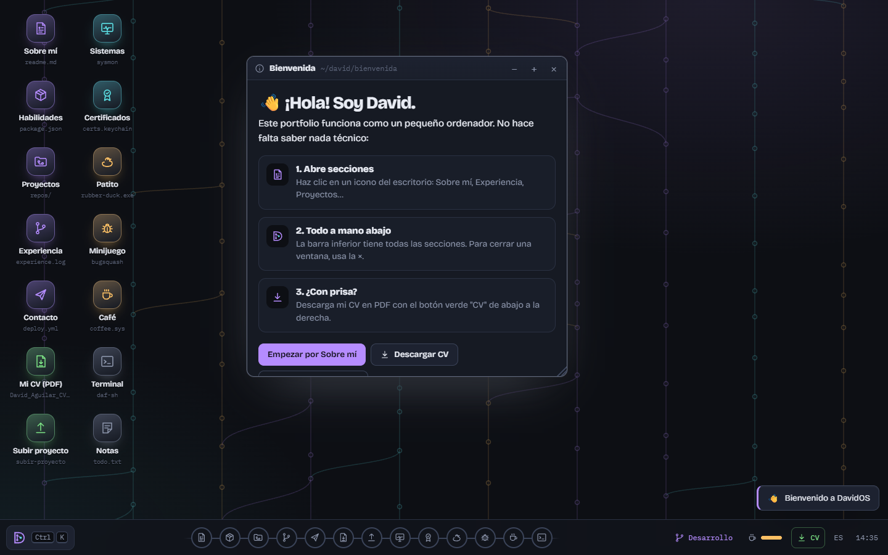

# DavidOS

**El portfolio de David Aguilar Fernández, desarrollador web junior, con forma de sistema operativo propio.**

🔗 **https://davidaguilar.netlify.app**



## Qué es
Un pequeño "sistema operativo" hecho a mano en el navegador. Cada sección del CV es una app con su propia ventana:

- **Sobre mí**: ficha "En 30 segundos", por qué yo e idiomas.
- **Experiencia**: línea de tiempo, o un `git log` con ramas si activas "Ver como developer".
- **Habilidades**: niveles por categoría, o un `package.json` en la vista developer.
- **Proyectos**: galería con imagen, tecnologías y enlace a GitHub.
- **Contacto**: formulario (Netlify Forms), email, LinkedIn y GitHub.
- **Mi CV (PDF)**: visor y descarga.
- **Extras**: un patito debugger 🦆, un minijuego de aplastar bugs 🐛, una cafetera del sistema ☕ y una terminal (`daf-sh`).

Está pensado para que lo entienda cualquiera: lenguaje claro por defecto, guía de bienvenida y vista simple del CV en una página. El toque técnico es opcional.

## Tecnología
- **JavaScript vanilla** (sin frameworks) + **Vite**.
- Gestor de ventanas propio: arrastrar, redimensionar, minimizar y selección múltiple.
- Fondo generativo en **Canvas** (un grafo de commits animado).
- Bilingüe ES/EN, responsive, accesible (Lighthouse: accesibilidad, buenas prácticas y SEO al 100).
- Desplegado en **Netlify** con despliegue continuo desde GitHub.

## Ejecutar en local
```bash
npm install
npm run dev      # http://localhost:5173
npm run build    # genera dist/
```

## Añadir proyectos
Con `npm run dev` aparece la app **Subir proyecto** (solo en local, no se publica): arrastras la imagen de [shots.so](https://shots.so), rellenas título, descripción, tecnologías y enlace a GitHub, y se guarda en `src/data/projects.json` y `public/projects/`.

## Estructura
```
src/
  data/      contenido (cv.js, projects.json)
  os/        núcleo: ventanas, escritorio, barra, paleta, arranque…
  apps/      cada app de DavidOS
  styles/    estilos
vite-plugin-projects.js   API local del panel de subida (solo en dev)
```
